<h1 align="center">Hola, soy Diego A. Amaya A. 👋</h1>

<h3 align="center">Ingeniero de Software · Java · Spring Boot · Arquitectura de Software · Seguridad en el Desarrollo de Software</h3>

  
  
  

---

## 👨‍💻 Sobre mí

Arquitecto y desarrollador de software con experiencia en **Java, Spring Boot, Oracle PL/SQL y servicios REST/SOAP**, y formación en **Desarrollo de Aplicaciones Web Empresariales**. Me interesa construir aplicaciones backend claras y mantenibles, diseñar arquitectura de software, garantizar la calidad del software y verificar la seguridad de lo que desarrollo.

- 🏗️ Diseño de arquitectura de software y desarrollo de APIs REST.
- 🔐 Diseño y ejecución de pruebas (unitarias, funcionales, desempeño, sistema, integración, aceptación).
- 🔐 Verificación y pruebas de seguridad (fuzzing, detección de vulnerabilidades, criptografía).
- 📚 Código simple y explicable.

---

## 🛠️ Stack técnico

| Área | Tecnologías |
|---|---|
| **Arquitectura** | Monolítica, Microservicios |
| **Backend** | Java 8, Spring Boot, JPA/Hibernate, Lombok, Log4j2, Gson |
| **Bases de datos** | PostgreSQL, Oracle (SQL / PL-SQL) |
| **Servicios** | REST, SOAP, documentación con Swagger/springdoc |
| **Seguridad** | Criptografía (AES, RSA), pruebas de seguridad, fuzzing |
| **Herramientas** | Maven, Git, GitHub, Jenkins, Docker, SonarQube, Nexus |
| **Servidores** | Tomcat, WebSphere, WebLogic |

---

## 🏅 Certificaciones

  <a href="https://certmind.org/platform/public/index.php/mycertificate/download/33333" target="_blank">
    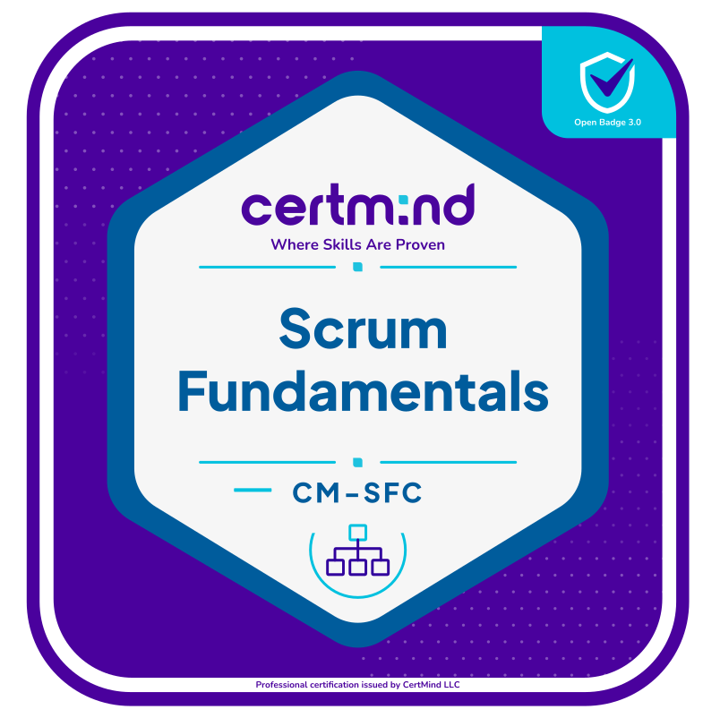
  </a>
  <a href="https://www.credly.com/earner/earned/badge/1b74587c-07fa-4102-ad63-f43afdd87eef" target="_blank">
    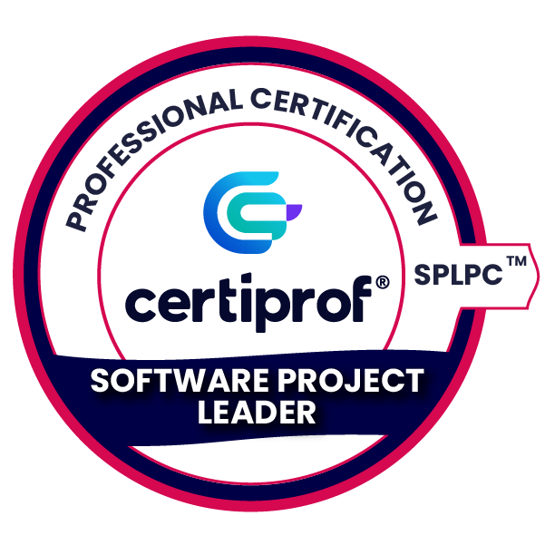
  </a>
  <a href="https://www.credly.com/earner/earned/badge/0b1c8f85-57a3-4b9d-a719-86c43ee9892d" target="_blank">
    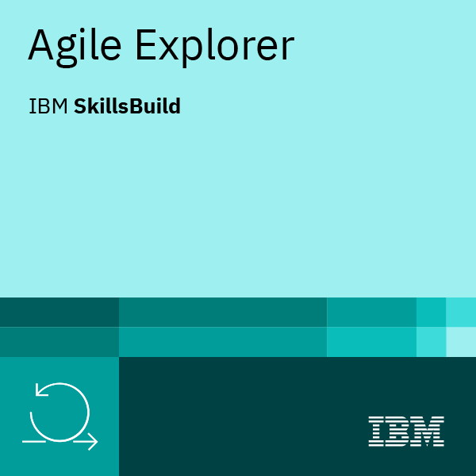
  </a>
  
  <a target="_blank">
    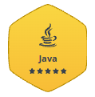
  </a>
  <a target="_blank">
    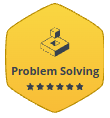
  </a>
  <a target="_blank">
    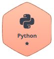
  </a>
  <a target="_blank">
    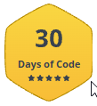
  </a>
  <a target="_blank">
    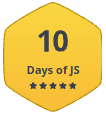
  </a>
  <a target="_blank">
    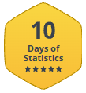
  </a>
  <a target="_blank">
    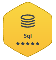
  </a>
  <a target="_blank">
    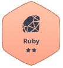
  </a>
  <a href="https://www.hackerrank.com/certificates/iframe/ac06ff896037" target="_blank">
    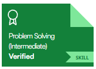
  </a>
  
  <a href="https://www.hackerrank.com/certificates/iframe/5b825cd1f878" target="_blank">
    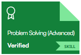
  </a>
  <a href="https://www.hackerrank.com/certificates/iframe/41671074b7d5" target="_blank">
    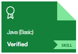
  </a>
  <a href="https://www.hackerrank.com/certificates/iframe/0f641e335e7b" target="_blank">
    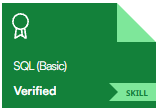
  </a>
  
  <a href="https://www.hackerrank.com/certificates/iframe/0f641e335e7b" target="_blank">
    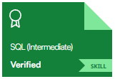
  </a>
  <a href="https://www.hackerrank.com/certificates/iframe/c33f51f95b8f" target="_blank">
    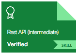
  </a>
  <a href="https://www.hackerrank.com/certificates/iframe/bd28d1c5e428" target="_blank">
    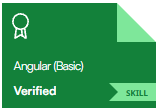
  </a>
  <a href="https://www.hackerrank.com/certificates/iframe/445353a9e946" target="_blank">
    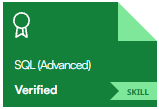
  </a>
  <a href="https://www.hackerrank.com/certificates/iframe/c43841f75b50" target="_blank">
    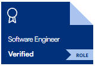
  </a>
  <a href="https://www.hackerrank.com/certificates/iframe/a85bfb85e57e" target="_blank">
    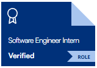
  </a>

  

---

## 🚀 Proyectos destacados

### 🔐 [techcommerce-security](https://github.com/daamayaaa/techcommerce-security)
Proyecto integrador de **verificación y pruebas de seguridad de software**. Caso de estudio: microservicio de catálogo de productos de TechCommerce S.A.S. `Java`

### 🛡️ [proyecto_integrador_seguridad_desarrollo_software](https://github.com/daamayaaa/proyecto_integrador_seguridad_desarrollo_software)
Verificación, pruebas de seguridad, **fuzzing y detección de vulnerabilidades** en un servicio Spring Boot. `Java` `Spring Boot`

### 🔑 [proyecto_criptografia_cifrado_simetrico](https://github.com/daamayaaa/proyecto_criptografia_cifrado_simetrico)
Ejemplo funcional de un criptosistema **simétrico (clave privada) con AES**. `Java`

### 🗝️ [proyecto_criptosistema_llave_publica](https://github.com/daamayaaa/proyecto_criptosistema_llave_publica)
Ejemplo funcional de un criptosistema de **llave pública con el algoritmo RSA**. `Java`

### 🗂️ [proyecto_prueba_categoria_crud_v1](https://github.com/daamayaaa/proyecto_prueba_categoria_crud_v1)
CRUD de categorías con arquitectura por capas, pensado como ejemplo didáctico de API REST. `Java`

### 📟 [MonitorVisualInstrumentosElectronicos](https://github.com/daamayaaa/MonitorVisualInstrumentosElectronicos)
Monitor visual de instrumentos electrónicos. `Java`

---

## 🎓 Formación y experiencia

### Formación
- **Especialista en Desarrollo de Software** — Corporación Universitaria Minuto de Dios (UNIMINUTO), Facultad de Ingeniería. Construcción de software, frameworks web, verificación y pruebas de seguridad, y gestión de proyectos de software.
- **Ingeniero de Sistemas** — Politécnico Grancolombiano, Facultad de Ingeniería. Ingeniería de software, frameworks web, análisis y diseño de algoritmos y gestión de proyectos de software.
- **Tecnólogo en Informática** — Corporación Universitaria Minuto de Dios (UNIMINUTO), Facultad de Ingeniería. Ingeniería de software, lenguajes de programación, bases de datos y sistemas operativos.

### Experiencia profesional
- **Globant** (sep 2021 – may 2022): desarrollo de software con Java y Spring Boot.
- **VASS Latam** (hasta jun 2020): desarrollo de software con Java/Spring Boot, Oracle PL/SQL y servicios REST.
- **Amaris** (jun 2019 - oct 2020): desarrollo de software con Java/Spring Boot, Oracle PL/SQL y servicios REST.
- **TryCore** (ene 2018 - feb 2089): arquitectura de software, desarrollo de software con Java/Spring Boot, servicios REST.
- **Indra - Tecnocom** (jun 2016 - nov 2017): desarrollo de software con Java/Spring Boot, Angular, JavaEE y servicios SOAP.
- **Kibernum** (dic 2015 - may 2016): desarrollo de software con JavaEE, Oracle PL/SQL.
- **Asesoftware** (jul 2011 - sep 2015): desarrollo de software con JavaEE, Oracle PL/SQL, Primefaces, servicios REST/SOAP, SOAU-UI, Oracle WebLogic, UML.
- **ADA S. A.** (dic 2015 - dic 2010): desarrollo de software con JavaEE, JSF, Hibernate, Oracle PL/SQL.
- **Kaome Studio** (jul 2008 - oct 2008): desarrollo de software con PHP, MySQL.
- **GFE Colombia** (sep 2007 - oct 2008): Mantenimiento de portales Wev con Joomla, HTML, Google Analytics.

---

## 📌 En lo que me enfoco

- Arquitectura de software con Spring Boot (vistas y perspectivas de arquitectura)
- Calidad en el ciclo de desarrollo: diseño, planificación y ejecución de pruebas de software
- Seguridad en el ciclo de desarrollo: pruebas, verificación y criptografía
- Gestión de proyectos de software: planeación, riesgos y control y seguimiento

---

## 📊 Estadísticas de GitHub

  
  

---

## 📫 Contacto

¿Hablamos de un proyecto o una oportunidad? Escríbeme a **calderonenator@gmail.com** o por [LinkedIn](https://www.linkedin.com/in/damayaarjona).

<i>"Código simple, claro y seguro."</i>

